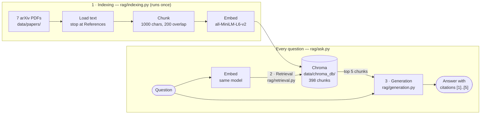
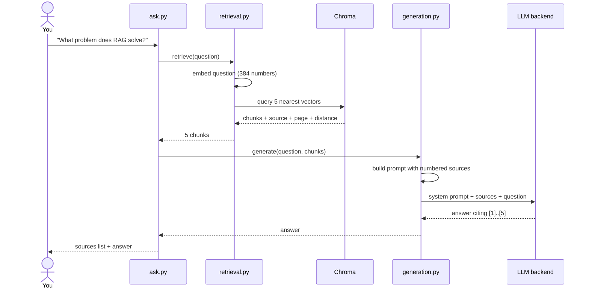
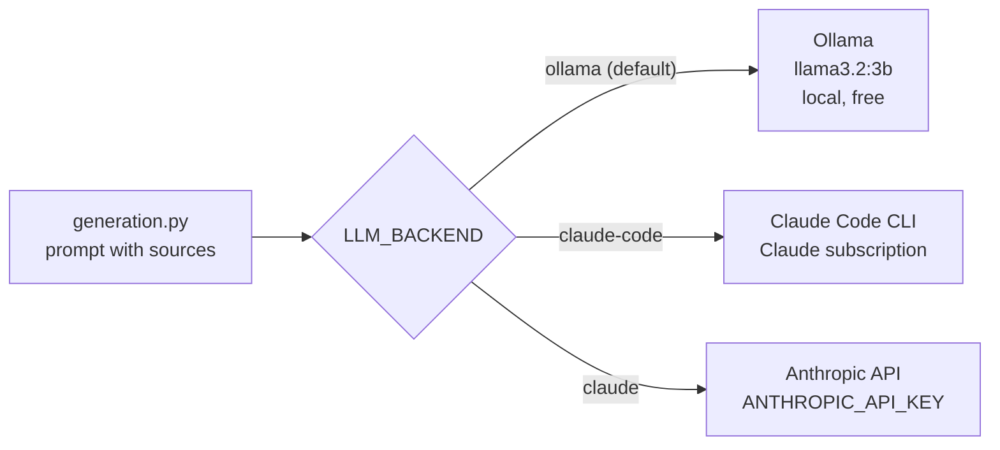
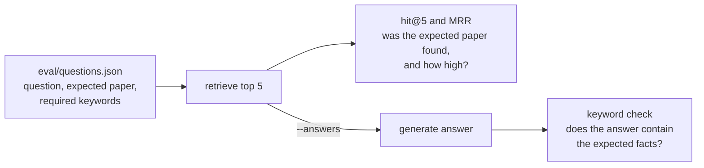

# rag-from-papers

A minimal Retrieval-Augmented Generation (RAG) app that answers questions
about classic AI research papers, using either a local model (free, offline) or Claude.

I built this to learn how RAG works under the hood, while following LangChain's
*RAG From Scratch* series (parts 1–4). Everything is kept small and readable on
purpose: one file per stage, no frameworks.

**How RAG works, explained with this project's numbers:** [jotavare.github.io/rag-from-papers](https://jotavare.github.io/rag-from-papers/)

## Project structure

```
rag-from-papers/
├── rag/                    # the pipeline
│   ├── config.py           # paths and shared settings
│   ├── download_papers.py  # setup: fetch the papers from arXiv
│   ├── indexing.py         # stage 1: PDFs → chunks → embeddings → Chroma
│   ├── retrieval.py        # stage 2: question → 5 most similar chunks
│   ├── generation.py       # stage 3: chunks + question → LLM → cited answer
│   └── ask.py              # runs retrieval, then generation
├── eval/
│   ├── questions.json      # 14 questions with known answers
│   └── run_eval.py         # scores retrieval and answers
├── docs/
│   └── index.html          # the explainer page (GitHub Pages)
└── data/                   # created locally, not committed
    ├── papers/             # downloaded PDFs
    └── chroma_db/          # vector database
```

## How it works

Indexing runs once, ahead of time. Retrieval and generation run on every question.



What happens during one `python -m rag.ask "..."` call:



## Setup

```bash
python -m venv .venv
.venv\Scripts\activate          # Windows  (macOS/Linux: source .venv/bin/activate)
pip install -r requirements.txt
python -m rag.download_papers   # 7 papers from arXiv into data/papers/
python -m rag.indexing          # builds data/chroma_db/
```

The papers are downloaded rather than committed, because arXiv's default license doesn't allow redistributing them.

## Usage

```bash
python -m rag.ask "What problem does retrieval-augmented generation solve?"
```

### Choosing the model that writes answers

Set `LLM_BACKEND` (retrieval is the same for all of them):



| Backend | Needs | Notes |
|---------|-------|-------|
| `ollama` (default) | [Ollama](https://ollama.com) + `ollama pull llama3.2:3b` | Free and offline; ~1 min per answer on CPU. Change model with `OLLAMA_MODEL` |
| `claude-code` | [Claude Code](https://claude.com/claude-code) signed in to a Claude subscription | Counts against the plan's usage limits; no API key |
| `claude` | `ANTHROPIC_API_KEY` | Anthropic API; change model with `CLAUDE_MODEL` |

```bash
# PowerShell: pick another backend for this terminal
$env:LLM_BACKEND = "claude-code"
python -m rag.ask "How does ReAct combine reasoning and acting?"
```

## Evaluation

`eval/questions.json` holds 14 questions with known answers: 13 answerable from a specific paper, plus one off-topic question the app should refuse.

```bash
python -m eval.run_eval             # retrieval only: free, a few seconds
python -m eval.run_eval --answers   # also generate answers with LLM_BACKEND and keyword-check them
```



### Results

| Run | Chunking | Embedding model | hit@5 | MRR | Answers |
|-----|----------|-----------------|-------|-----|---------|
| Baseline | 1000 chars, 200 overlap | all-MiniLM-L6-v2 | 13/13 | 0.89 | 12/14 (Claude) |

Both answer failures ask about the original RAG paper (Lewis et al.). The paper was retrieved, but not the passage holding the answer, and the model correctly replied that the sources don't say. Finding the right paper isn't enough; the right chunk has to be found too.

## What I learned

- **Bad chunks look relevant.** My first index had 796 chunks, and half were bibliography pages. Reference lists are full of keywords like "retrieval", so they ranked high for almost every question while containing no answers. Skipping everything after the "References" heading halved the index and fixed the results.
- **Retrieval and generation are independent.** The same 5 chunks came back no matter which LLM wrote the answer. Swapping models only changed the writing quality, which is why the backend is a single setting.
- **Grounding works, but it exposes retrieval gaps.** Telling the model to use only the sources made it say "I don't know" instead of guessing. Every remaining failure is a retrieval problem I can see and measure.
- **Measure before changing things.** One test question told me very little. A fixed set of 14 questions gives a baseline to compare every change against.

## Next steps

- [ ] Try a stronger embedding model (e.g. `BAAI/bge-small-en-v1.5`); the current one reads only 256 tokens per chunk
- [ ] Contextual Retrieval (Anthropic): add context to each chunk before embedding, then re-run the eval
- [ ] Re-ranking retrieved chunks
- [ ] Query rewriting / multi-query (RAG From Scratch part 5+)
- [x] A small evaluation set to measure whether changes actually help
